# SkyNest Hotels Reservation and Guest Services Management System (HRGSMS)
## Relational Database Design — Full Academic & Implementation Report

---

## 1. Understanding of the SRS

SkyNest operates multiple **hotel branches** (Colombo, Kandy, Galle), each with its own inventory of **rooms** grouped into **room types** with type-specific amenities and pricing. Guests may book **with or without** a loyalty membership. Registered members accrue **loyalty points** (expiring after 365 days) that roll up into **Silver/Gold/Platinum tiers** with tier-specific discounts. During a stay, guests may consume **paid services** (spa, laundry, room service, etc.) whose price at the moment of use must be frozen for billing integrity even if the catalogue price later changes. A stay produces a single **bill**, computed from room + service charges through a fixed **Sri Lankan-style tax cascade** (Service Charge 10%, TDL 1%, SSCL 2.5%, VAT 18% on top), and settled through **one or more payments**. Front-desk **staff** operate under **role-based access** (Receptionist, Service Staff, Manager, Administrator), and the system must maintain an **audit trail** of sensitive state changes. The single hardest structural requirement is that **the database itself — not just the UI — must prevent two overlapping reservations for the same room**.

The design below treats these as hard constraints: BCNF wherever theoretically and practically sound, 3NF as an absolute floor, no repeating groups, no comma-separated values, no redundant derivable columns except where explicitly justified as a financial/historical snapshot.

---

## 2. Business Rules Extracted

| # | Rule | DB Design Implication |
|---|------|------------------------|
| B1 | Multiple branches, each with its own rooms | `Branch` 1—N `Room`; room numbers unique **per branch**, not globally |
| B2 | Room has type, status, branch | `Room` FK to `RoomType`, FK to `Branch`, `status` enum |
| B3 | No double-booking of a room for overlapping dates — DB-enforced | `ReservationNight` occupancy-calendar table with composite PK |
| B4 | Walk-in guest can book without a member account | `Guest` is the universal party table; `Member` is an optional 1:1 extension |
| B5 | Members have points, tier, tier benefits | `Member`, `LoyaltyTier`, `LoyaltyPointTransaction` |
| B6 | Points awarded after eligible completed stay, expire after 365 days, ledger-based | `LoyaltyPointTransaction` (EARN/REDEEM/EXPIRE/ADJUSTMENT) with `expires_at`; no stored running balance by default |
| B7 | Service catalogue price can change; historical usage price must be frozen | `Service.current_price` (mutable) vs `ServiceUsage.unit_price_at_usage` (immutable snapshot) |
| B8 | Bill = Room + Services, cascading Service Charge/TDL/SSCL/VAT, discounts, payments | `Bill` stores the frozen tax **snapshot amounts**; rates come from a versioned `TaxConfig` |
| B9 | Multiple partial payments per bill | `Bill` 1—N `Payment` |
| B10 | Check-in/out timestamps, room status transitions, no checkout with balance due | `StayCheckInOut`, triggers/procedure `sp_CheckOut` |
| B11 | Staff have RBAC roles, assigned to a branch | `Staff` N—1 `Branch`, `Staff` M—N `Role` via `StaffRole` |
| B12 | Audit trail for critical actions | `AuditLog` (polymorphic, table_name + record_id) |

---

## 3. Entities Identified

| Entity | Why it is needed |
|---|---|
| **Branch** | Physical hotel location; scopes rooms, staff, services, rates |
| **RoomType** | Category (Standard/Deluxe/Suite) shared by many rooms; defines occupancy limits and standard amenities |
| **Amenity** | Reusable feature (WiFi, TV, AC…) — must not be a comma list |
| **RoomTypeAmenity** | Resolves the M:N between RoomType and Amenity |
| **Room** | Physical bookable unit; belongs to exactly one branch and one type |
| **RoomRate** | Nightly price per (branch, room type), versioned over time — prices change, history must not |
| **Guest** | Universal party for anyone who stays, member or not — avoids duplicating contact data |
| **LoyaltyTier** | Silver/Gold/Platinum definition and default discount |
| **Member** | Optional 1:1 extension of Guest holding membership-only attributes |
| **LoyaltyPointTransaction** | Ledger of every point event; the only reliable way to support expiry and auditability |
| **Role** | Named RBAC role, not a free-text field |
| **Staff** | Employee record, branch-scoped |
| **StaffRole** | Resolves M:N between Staff and Role |
| **UserAccount** | Login credentials, 1:1 with Staff — kept apart so HR data and auth data have different lifecycles/security needs |
| **Offer** | Reusable promotion/coupon definition |
| **Reservation** | The booking intent: who, which room, which dates, what was agreed |
| **ReservationNight** | One row per occupied room-night; the structural mechanism that makes double-booking impossible |
| **StayCheckInOut** | Actual (as opposed to planned) arrival/departure event data |
| **Service** | Sellable extra (spa, laundry…) with a current catalogue price |
| **ServiceUsage** | One row per consumption event, with a frozen price |
| **TaxConfig** | Versioned Service Charge/TDL/SSCL/VAT rates — rates are law/policy, not application constants |
| **Bill** | One frozen financial snapshot per reservation |
| **Payment** | One row per payment attempt/settlement against a bill |
| **AuditLog** | Who changed what, when |

No table was created purely because a noun appeared in the SRS (e.g., no separate "BillItem" table — see §20; no per-room amenity table — see §21).

---

## 4. Functional Dependencies (major relations)

Notation: PK attributes underlined conceptually via **bold**.

**Room**(**room_id**, branch_id, room_type_id, room_number, floor_number, status)
- FD1: room_id → branch_id, room_type_id, room_number, floor_number, status
- FD2: {branch_id, room_number} → room_id, room_type_id, floor_number, status
- No other attribute determines another → no partial/transitive dependency.

**RoomRate**(**room_rate_id**, branch_id, room_type_id, nightly_rate, effective_from, effective_to)
- FD1: room_rate_id → all other attributes
- FD2: {branch_id, room_type_id, effective_from} → room_rate_id, nightly_rate, effective_to
- nightly_rate depends on the *whole* {branch_id, room_type_id, effective_from} combination, not on any subset (same branch has different rates per type; same type has different rates per branch).

**Reservation**(**reservation_id**, room_id, guest_id, offer_id, created_by_staff_id, check_in_date, check_out_date, num_guests, agreed_nightly_rate, booking_status, created_at)
- FD1: reservation_id → all other attributes
- No other attribute set is unique, so no alternate candidate key and no partial/transitive dependency risk.
- Deliberately **excludes** branch_id and room_type_id — both are transitively obtainable via room_id → Room.branch_id / Room.room_type_id, so storing them here would be a textbook transitive-dependency redundancy.

**ReservationNight**(**room_id, stay_date**, reservation_id) — *see full BCNF analysis in §7, this is the schema's one deliberate exception*
- FD1: {room_id, stay_date} → reservation_id (this is the whole point: a room+night can host at most one active reservation)
- FD2: {reservation_id, stay_date} → room_id (a reservation occupies exactly one room per night)
- FD3 (derived, non-trivial): reservation_id → room_id (because a reservation is tied to a single room for its entire stay)

**ServiceUsage**(**usage_id**, reservation_id, service_id, recorded_by_staff_id, quantity, unit_price_at_usage, usage_datetime, line_total)
- FD1: usage_id → all other attributes
- line_total is **not** an independent fact; it is a MySQL `GENERATED ALWAYS AS (quantity * unit_price_at_usage) STORED` column, so it is not a "stored redundant attribute" in the classical anomaly sense — the engine, not the application, guarantees quantity/price/total consistency.

**Bill**(**bill_id**, reservation_id, tax_config_id, generated_at, base_amount, service_charge_amount, tdl_amount, sscl_amount, vat_amount, discount_amount, total_amount, bill_status)
- FD1: bill_id → all other attributes
- FD2: reservation_id → all other attributes (UNIQUE — a 1:1 with Reservation)
- Two single-attribute candidate keys, both trivially superkeys → no violation.

**Member**(**member_id**, membership_number, tier_id, enrolled_at)
- FD1: member_id → membership_number, tier_id, enrolled_at
- FD2: membership_number → member_id, tier_id, enrolled_at

**LoyaltyPointTransaction**(**txn_id**, member_id, txn_type, points, reservation_id, earned_at, expires_at)
- FD1: txn_id → all other attributes. No other combination is guaranteed unique (a member could earn/redeem multiple times against the same reservation), so txn_id is the sole candidate key.

---

## 5. Candidate Keys (summary)

| Relation | Candidate Key(s) |
|---|---|
| Branch | {branch_id}, {branch_name} |
| RoomType | {room_type_id}, {type_name} |
| Amenity | {amenity_id}, {amenity_name} |
| RoomTypeAmenity | {room_type_id, amenity_id} |
| Room | {room_id}, {branch_id, room_number} |
| RoomRate | {room_rate_id}, {branch_id, room_type_id, effective_from} |
| Guest | {guest_id}, {id_document_type, id_document_number} |
| LoyaltyTier | {tier_id}, {tier_name} |
| Member | {member_id}, {membership_number} |
| LoyaltyPointTransaction | {txn_id} |
| Role | {role_id}, {role_name} |
| Staff | {staff_id}, {email} |
| StaffRole | {staff_id, role_id} |
| UserAccount | {user_account_id}, {staff_id}, {username} |
| Offer | {offer_id}, {offer_code} |
| Reservation | {reservation_id} |
| ReservationNight | {room_id, stay_date}, {reservation_id, stay_date} |
| StayCheckInOut | {reservation_id} |
| Service | {service_id}, {branch_id, service_name} |
| ServiceUsage | {usage_id} |
| TaxConfig | {tax_config_id} |
| Bill | {bill_id}, {reservation_id} |
| Payment | {payment_id} |
| AuditLog | {audit_id} |

---

## 6. Normalization Analysis

**1NF** — every relation above stores only atomic, single-valued attributes. The two places the SRS explicitly warns against (amenities, roles) are modeled as junction tables (`RoomTypeAmenity`, `StaffRole`), not comma-separated text.

**2NF** — every relation either has a single-column PK (partial dependency is structurally impossible) or, for the composite-key relations (`RoomTypeAmenity`, `StaffRole`, `ReservationNight`), every non-key attribute depends on the *whole* key, not a subset. `ReservationNight` has no non-key attribute other than `reservation_id`, which (as shown in §4) depends on the *whole* key {room_id, stay_date} — no partial dependency.

**3NF** — checked relation by relation in §4/§7; the only attribute that is transitively derivable and was deliberately *excluded* to satisfy 3NF is (branch_id, room_type_id) on `Reservation`, and (branch_name, room_type_name) anywhere a natural-language "denormalized" version would have embedded them (see the worked example in §7.3).

**BCNF** — every relation satisfies BCNF **except `ReservationNight`**, which is documented in §7.2 as a deliberate, isolated exception.

---

## 7. BCNF Decomposition — Worked Examples

### 7.1 Anti-example: the "one giant Booking table" (why it was never built)

A naive first draft might look like:

```
Booking(BookingID, GuestName, GuestPhone, RoomNumber, RoomTypeName, BranchName,
        NightlyRate, Service1, Service2, Service3, Payment1Amount, Payment2Amount,
        LoyaltyPointsBalance, TotalDue)
```

**Problems (why this never reaches even 1NF/2NF):**
- `Service1/Service2/Service3` and `Payment1/Payment2` are **repeating groups** — a 4th service or 3rd payment breaks the schema (violates 1NF).
- FD `RoomNumber → RoomTypeName, BranchName` is **transitive** through `RoomNumber` rather than depending on `BookingID` directly (violates 3NF once flattened into 1NF).
- `GuestName, GuestPhone` depend only on `GuestID`, not on the full booking (partial dependency once a composite key is introduced) → insertion anomaly (can't store a guest without a booking), update anomaly (guest's phone must be corrected in every booking row), deletion anomaly (deleting the last booking deletes the only record of the guest).

**Decomposition** (the actual schema): `Guest`, `Room` (→`Branch`, `RoomType`), `Reservation`, `ServiceUsage` (→`Service`), `Payment` (→`Bill`), `LoyaltyPointTransaction` (→`Member`). Each resulting relation's non-key attributes depend on the whole key and nothing but the key — this is precisely §8.

### 7.2 The one deliberate BCNF exception: `ReservationNight`

```
ReservationNight(room_id, stay_date, reservation_id)
```

Candidate keys: **K1** = {room_id, stay_date}, **K2** = {reservation_id, stay_date} (a reservation never repeats the same night twice).

Non-trivial FD: **reservation_id → room_id** (a reservation is tied to one room for its whole stay).

BCNF test: is `reservation_id` a superkey? **No** — `{reservation_id}` alone does not determine `stay_date`. Therefore this FD's determinant is not a superkey → **BCNF is violated**.

3NF test: is `room_id` a prime attribute (part of some candidate key)? **Yes** — it is part of K1. Under 3NF's exception clause this is acceptable → **the relation satisfies 3NF but not BCNF.**

**Textbook decomposition would be:**
```
ReservationRoom(reservation_id, room_id)          -- FD: reservation_id → room_id, now a proper key
ReservationDates(reservation_id, stay_date)        -- just an exploded calendar, no room_id
```
This is lossless (common attribute `reservation_id` is a key of `ReservationRoom`) and dependency-preserving. **However, it was deliberately rejected**, because the entire reason `ReservationNight` exists is to let MySQL's own unique index — `PRIMARY KEY (room_id, stay_date)` — do the double-booking prevention atomically, without a range/interval comparison. Splitting `room_id` out of the calendar table removes the exact column pair the uniqueness constraint needs, reintroducing the interval-overlap problem the table was built to eliminate.

**Trade-off accepted:** a single, structurally-necessary, non-BCNF relation with a *controlled* redundancy (room_id repeated once per night, always written once at reservation creation, never independently updated) in exchange for **guaranteed, engine-level, race-condition-free prevention of double-booking** — the SRS's single hardest requirement. This is the only relation in the schema that is 3NF but not BCNF, and it is called out explicitly rather than silently accepted.

### 7.3 Worked example matching the requested `R(A,B,C,D)` template

```
R(RoomRateID, BranchID, RoomTypeID, EffectiveFrom, NightlyRate, BranchName, RoomTypeName)
```
FDs:
```
RoomRateID → BranchID, RoomTypeID, EffectiveFrom, NightlyRate, BranchName, RoomTypeName
BranchID → BranchName
RoomTypeID → RoomTypeName
```
Candidate key: `RoomRateID`

`BranchID → BranchName` and `RoomTypeID → RoomTypeName` are **transitive dependencies** on a non-key determinant (`BranchID`/`RoomTypeID` are not superkeys of R) → violates 3NF (and therefore BCNF).

**Decomposition:**
```
Branch(BranchID, BranchName, ...)
RoomType(RoomTypeID, TypeName, ...)
RoomRate(RoomRateID, BranchID, RoomTypeID, EffectiveFrom, NightlyRate)
```
**Lossless:** the common attributes (`BranchID`, `RoomTypeID`) are keys of `Branch`/`RoomType` respectively, so the join reconstructs R exactly. **Dependency-preserving:** yes — every original FD is enforceable in one of the three relations. **BCNF:** all three relations now have every determinant as a superkey. This is exactly why the real schema never stores `BranchName`/`RoomTypeName` on `Room`, `RoomRate`, `Reservation`, `Service`, or anywhere else — they are always one join away.

---

## 8. Final Relational Schema

### Table: Branch
| Attribute | Data Type | Constraints | Description |
|---|---|---|---|
| branch_id | BIGINT | PK, AUTO_INCREMENT | Unique branch identifier |
| branch_name | VARCHAR(100) | UNIQUE, NOT NULL | e.g. "Colombo" |
| city | VARCHAR(100) | NOT NULL | |
| address_line | VARCHAR(255) | NOT NULL | |
| phone | VARCHAR(20) | NOT NULL | |
| email | VARCHAR(150) | NULL | |
| is_active | BOOLEAN | NOT NULL, DEFAULT TRUE | |

### Table: RoomType
| Attribute | Data Type | Constraints | Description |
|---|---|---|---|
| room_type_id | BIGINT | PK, AUTO_INCREMENT | |
| type_name | VARCHAR(50) | UNIQUE, NOT NULL | Standard/Deluxe/Suite |
| description | VARCHAR(500) | NULL | |
| max_occupancy | SMALLINT | NOT NULL, CHECK > 0 | |

### Table: Amenity
| Attribute | Data Type | Constraints | Description |
|---|---|---|---|
| amenity_id | BIGINT | PK, AUTO_INCREMENT | |
| amenity_name | VARCHAR(100) | UNIQUE, NOT NULL | WiFi, TV, AC, Mini Bar… |

### Table: RoomTypeAmenity (junction)
| Attribute | Data Type | Constraints | Description |
|---|---|---|---|
| room_type_id | BIGINT | PK, FK → RoomType | |
| amenity_id | BIGINT | PK, FK → Amenity | |

### Table: Room
| Attribute | Data Type | Constraints | Description |
|---|---|---|---|
| room_id | BIGINT | PK, AUTO_INCREMENT | |
| branch_id | BIGINT | FK → Branch, NOT NULL | |
| room_type_id | BIGINT | FK → RoomType, NOT NULL | |
| room_number | VARCHAR(10) | NOT NULL | Unique **within** branch |
| floor_number | SMALLINT | NULL | |
| status | ENUM('AVAILABLE','OCCUPIED','MAINTENANCE','OUT_OF_SERVICE') | NOT NULL, DEFAULT 'AVAILABLE' | |
| | | UNIQUE(branch_id, room_number) | |

### Table: RoomRate
| Attribute | Data Type | Constraints | Description |
|---|---|---|---|
| room_rate_id | BIGINT | PK, AUTO_INCREMENT | |
| branch_id | BIGINT | FK → Branch, NOT NULL | |
| room_type_id | BIGINT | FK → RoomType, NOT NULL | |
| nightly_rate | DECIMAL(10,2) | NOT NULL, CHECK > 0 | |
| effective_from | DATE | NOT NULL | |
| effective_to | DATE | NULL | NULL = currently effective |
| | | UNIQUE(branch_id, room_type_id, effective_from) | |

### Table: Guest
| Attribute | Data Type | Constraints | Description |
|---|---|---|---|
| guest_id | BIGINT | PK, AUTO_INCREMENT | |
| first_name | VARCHAR(80) | NOT NULL | |
| last_name | VARCHAR(80) | NOT NULL | |
| email | VARCHAR(150) | NULL | |
| phone | VARCHAR(20) | NOT NULL | |
| id_document_type | ENUM('NIC','PASSPORT','DRIVER_LICENSE') | NOT NULL | |
| id_document_number | VARCHAR(50) | NOT NULL | |
| nationality | VARCHAR(60) | NULL | |
| created_at | TIMESTAMP | NOT NULL, DEFAULT CURRENT_TIMESTAMP | |
| | | UNIQUE(id_document_type, id_document_number) | |

### Table: LoyaltyTier
| Attribute | Data Type | Constraints | Description |
|---|---|---|---|
| tier_id | BIGINT | PK, AUTO_INCREMENT | |
| tier_name | ENUM('SILVER','GOLD','PLATINUM') | UNIQUE, NOT NULL | |
| min_points_threshold | INT | NOT NULL | |
| default_discount_percentage | DECIMAL(5,2) | NOT NULL, DEFAULT 0.00 | |

### Table: Member
| Attribute | Data Type | Constraints | Description |
|---|---|---|---|
| member_id | BIGINT | PK, FK → Guest(guest_id) | 1:1 extension of Guest |
| membership_number | VARCHAR(20) | UNIQUE, NOT NULL | |
| tier_id | BIGINT | FK → LoyaltyTier, NOT NULL | |
| enrolled_at | DATE | NOT NULL, DEFAULT (CURRENT_DATE) | |

### Table: LoyaltyPointTransaction
| Attribute | Data Type | Constraints | Description |
|---|---|---|---|
| txn_id | BIGINT | PK, AUTO_INCREMENT | |
| member_id | BIGINT | FK → Member, NOT NULL | |
| txn_type | ENUM('EARN','REDEEM','EXPIRE','ADJUSTMENT') | NOT NULL | |
| points | INT | NOT NULL, CHECK sign matches txn_type | +earn, −redeem/expire |
| reservation_id | BIGINT | FK → Reservation, NULL | source of an EARN |
| earned_at | DATETIME | NOT NULL, DEFAULT CURRENT_TIMESTAMP | |
| expires_at | DATE | NULL | set on EARN rows = earned_at + 365d |

### Table: Role
| Attribute | Data Type | Constraints | Description |
|---|---|---|---|
| role_id | BIGINT | PK, AUTO_INCREMENT | |
| role_name | ENUM('RECEPTIONIST','SERVICE_STAFF','MANAGER','ADMINISTRATOR') | UNIQUE, NOT NULL | |

### Table: Staff
| Attribute | Data Type | Constraints | Description |
|---|---|---|---|
| staff_id | BIGINT | PK, AUTO_INCREMENT | |
| branch_id | BIGINT | FK → Branch, NOT NULL | |
| first_name | VARCHAR(80) | NOT NULL | |
| last_name | VARCHAR(80) | NOT NULL | |
| email | VARCHAR(150) | UNIQUE, NOT NULL | |
| phone | VARCHAR(20) | NULL | |
| hire_date | DATE | NOT NULL | |
| employment_status | ENUM('ACTIVE','ON_LEAVE','TERMINATED') | NOT NULL, DEFAULT 'ACTIVE' | |

### Table: StaffRole (junction — proper RBAC, not Role1/Role2 columns)
| Attribute | Data Type | Constraints | Description |
|---|---|---|---|
| staff_id | BIGINT | PK, FK → Staff | |
| role_id | BIGINT | PK, FK → Role | |

### Table: UserAccount
| Attribute | Data Type | Constraints | Description |
|---|---|---|---|
| user_account_id | BIGINT | PK, AUTO_INCREMENT | |
| staff_id | BIGINT | FK → Staff, UNIQUE, NOT NULL | 1:1 with Staff |
| username | VARCHAR(50) | UNIQUE, NOT NULL | |
| password_hash | VARCHAR(255) | NOT NULL | |
| account_status | ENUM('ACTIVE','LOCKED','DISABLED') | NOT NULL, DEFAULT 'ACTIVE' | |
| last_login_at | DATETIME | NULL | |

### Table: Offer
| Attribute | Data Type | Constraints | Description |
|---|---|---|---|
| offer_id | BIGINT | PK, AUTO_INCREMENT | |
| offer_code | VARCHAR(30) | UNIQUE, NOT NULL | |
| description | VARCHAR(255) | NULL | |
| discount_type | ENUM('PERCENTAGE','FIXED_AMOUNT') | NOT NULL | |
| discount_value | DECIMAL(10,2) | NOT NULL, CHECK > 0 | |
| min_tier_id | BIGINT | FK → LoyaltyTier, NULL | tier-exclusive promos |
| valid_from | DATE | NOT NULL | |
| valid_to | DATE | NOT NULL, CHECK > valid_from | |
| is_active | BOOLEAN | NOT NULL, DEFAULT TRUE | |

### Table: Reservation
| Attribute | Data Type | Constraints | Description |
|---|---|---|---|
| reservation_id | BIGINT | PK, AUTO_INCREMENT | |
| room_id | BIGINT | FK → Room, NOT NULL | |
| guest_id | BIGINT | FK → Guest, NOT NULL | |
| offer_id | BIGINT | FK → Offer, NULL | |
| created_by_staff_id | BIGINT | FK → Staff, NULL | NULL = self-service/online |
| check_in_date | DATE | NOT NULL | |
| check_out_date | DATE | NOT NULL, CHECK > check_in_date | |
| num_guests | SMALLINT | NOT NULL, DEFAULT 1 | |
| agreed_nightly_rate | DECIMAL(10,2) | NOT NULL | **snapshot** of RoomRate at booking time |
| booking_status | ENUM('PENDING','CONFIRMED','CHECKED_IN','CHECKED_OUT','CANCELLED','NO_SHOW') | NOT NULL, DEFAULT 'PENDING' | |
| created_at | TIMESTAMP | NOT NULL, DEFAULT CURRENT_TIMESTAMP | |

### Table: ReservationNight (the double-booking guard — §7.2, §16)
| Attribute | Data Type | Constraints | Description |
|---|---|---|---|
| room_id | BIGINT | PK, FK → Room | |
| stay_date | DATE | PK | one row per occupied night |
| reservation_id | BIGINT | FK → Reservation, NOT NULL | |

### Table: StayCheckInOut
| Attribute | Data Type | Constraints | Description |
|---|---|---|---|
| reservation_id | BIGINT | PK, FK → Reservation | 1:1 with Reservation |
| check_in_datetime | DATETIME | NULL | |
| checked_in_by_staff_id | BIGINT | FK → Staff, NULL | |
| check_out_datetime | DATETIME | NULL, CHECK > check_in_datetime | |
| checked_out_by_staff_id | BIGINT | FK → Staff, NULL | |
| room_condition_note | VARCHAR(500) | NULL | |

### Table: Service
| Attribute | Data Type | Constraints | Description |
|---|---|---|---|
| service_id | BIGINT | PK, AUTO_INCREMENT | |
| branch_id | BIGINT | FK → Branch, NOT NULL | branch-scoped catalogue |
| service_name | VARCHAR(100) | NOT NULL | |
| category | VARCHAR(50) | NULL | |
| current_price | DECIMAL(10,2) | NOT NULL, CHECK ≥ 0 | mutable catalogue price |
| is_active | BOOLEAN | NOT NULL, DEFAULT TRUE | |
| | | UNIQUE(branch_id, service_name) | |

### Table: ServiceUsage
| Attribute | Data Type | Constraints | Description |
|---|---|---|---|
| usage_id | BIGINT | PK, AUTO_INCREMENT | |
| reservation_id | BIGINT | FK → Reservation, NOT NULL | |
| service_id | BIGINT | FK → Service, NOT NULL | |
| recorded_by_staff_id | BIGINT | FK → Staff, NULL | |
| quantity | DECIMAL(8,2) | NOT NULL, CHECK > 0 | |
| unit_price_at_usage | DECIMAL(10,2) | NOT NULL | **frozen** price |
| usage_datetime | DATETIME | NOT NULL, DEFAULT CURRENT_TIMESTAMP | |
| line_total | DECIMAL(12,2) | GENERATED ALWAYS AS (quantity*unit_price_at_usage) STORED | never independently writable |

### Table: TaxConfig
| Attribute | Data Type | Constraints | Description |
|---|---|---|---|
| tax_config_id | BIGINT | PK, AUTO_INCREMENT | |
| service_charge_rate | DECIMAL(5,4) | NOT NULL, DEFAULT 0.1000 | |
| tdl_rate | DECIMAL(5,4) | NOT NULL, DEFAULT 0.0100 | |
| sscl_rate | DECIMAL(5,4) | NOT NULL, DEFAULT 0.0250 | |
| vat_rate | DECIMAL(5,4) | NOT NULL, DEFAULT 0.1800 | |
| effective_from | DATE | NOT NULL | |
| effective_to | DATE | NULL | |

### Table: Bill
| Attribute | Data Type | Constraints | Description |
|---|---|---|---|
| bill_id | BIGINT | PK, AUTO_INCREMENT | |
| reservation_id | BIGINT | FK → Reservation, UNIQUE, NOT NULL | 1 bill per reservation |
| tax_config_id | BIGINT | FK → TaxConfig, NOT NULL | which rates were applied |
| generated_at | DATETIME | NOT NULL, DEFAULT CURRENT_TIMESTAMP | |
| base_amount | DECIMAL(12,2) | NOT NULL | Room + Services, pre-tax |
| service_charge_amount | DECIMAL(12,2) | NOT NULL | frozen snapshot |
| tdl_amount | DECIMAL(12,2) | NOT NULL | frozen snapshot |
| sscl_amount | DECIMAL(12,2) | NOT NULL | frozen snapshot |
| vat_amount | DECIMAL(12,2) | NOT NULL | frozen snapshot |
| discount_amount | DECIMAL(12,2) | NOT NULL, DEFAULT 0 | tier + offer combined |
| total_amount | DECIMAL(12,2) | NOT NULL | |
| bill_status | ENUM('OPEN','PARTIALLY_PAID','PAID','CANCELLED') | NOT NULL, DEFAULT 'OPEN' | maintained by trigger |

### Table: Payment
| Attribute | Data Type | Constraints | Description |
|---|---|---|---|
| payment_id | BIGINT | PK, AUTO_INCREMENT | |
| bill_id | BIGINT | FK → Bill, NOT NULL | |
| amount | DECIMAL(12,2) | NOT NULL, CHECK > 0 | |
| payment_method | ENUM('CASH','CARD','BANK_TRANSFER','ONLINE_GATEWAY') | NOT NULL | |
| payment_datetime | DATETIME | NOT NULL, DEFAULT CURRENT_TIMESTAMP | |
| reference_number | VARCHAR(100) | NULL | |
| payment_status | ENUM('COMPLETED','FAILED','REFUNDED') | NOT NULL, DEFAULT 'COMPLETED' | |
| recorded_by_staff_id | BIGINT | FK → Staff, NULL | |

### Table: AuditLog
| Attribute | Data Type | Constraints | Description |
|---|---|---|---|
| audit_id | BIGINT | PK, AUTO_INCREMENT | |
| table_name | VARCHAR(64) | NOT NULL | polymorphic target |
| record_id | BIGINT | NOT NULL | polymorphic target — no hard FK possible |
| action_type | ENUM('INSERT','UPDATE','DELETE') | NOT NULL | |
| changed_by_user_account_id | BIGINT | FK → UserAccount, NULL | NULL = system job |
| changed_at | DATETIME | NOT NULL, DEFAULT CURRENT_TIMESTAMP | |
| old_value | JSON | NULL | |
| new_value | JSON | NULL | |

---

## 9. ER Diagram — Mermaid

```mermaid
erDiagram
    BRANCH ||--o{ ROOM : "has"
    BRANCH ||--o{ STAFF : "employs"
    BRANCH ||--o{ ROOMRATE : "prices"
    BRANCH ||--o{ SERVICE : "offers"

    ROOMTYPE ||--o{ ROOM : "categorizes"
    ROOMTYPE ||--o{ ROOMRATE : "priced by"
    ROOMTYPE ||--o{ ROOMTYPEAMENITY : "has"
    AMENITY ||--o{ ROOMTYPEAMENITY : "included in"

    ROOM ||--o{ RESERVATION : "booked in"
    ROOM ||--o{ RESERVATIONNIGHT : "occupied on"

    GUEST ||--o| MEMBER : "optionally becomes"
    GUEST ||--o{ RESERVATION : "makes"
    LOYALTYTIER ||--o{ MEMBER : "classifies"
    MEMBER ||--o{ LOYALTYPOINTTRANSACTION : "accrues"

    ROLE ||--o{ STAFFROLE : "granted via"
    STAFF ||--o{ STAFFROLE : "holds"
    STAFF ||--o| USERACCOUNT : "logs in via"
    STAFF ||--o{ RESERVATION : "creates"
    STAFF ||--o{ SERVICEUSAGE : "records"
    STAFF ||--o{ PAYMENT : "records"

    OFFER ||--o{ RESERVATION : "applied to"
    LOYALTYTIER ||--o{ OFFER : "restricts (optional)"

    RESERVATION ||--|{ RESERVATIONNIGHT : "spans"
    RESERVATION ||--o| STAYCHECKINOUT : "actual stay of"
    RESERVATION ||--o{ SERVICEUSAGE : "incurs"
    RESERVATION ||--o{ LOYALTYPOINTTRANSACTION : "earns"
    RESERVATION ||--|| BILL : "settled by"

    SERVICE ||--o{ SERVICEUSAGE : "consumed as"

    TAXCONFIG ||--o{ BILL : "rates applied"
    BILL ||--o{ PAYMENT : "receives"

    USERACCOUNT ||--o{ AUDITLOG : "performs"

    BRANCH {
        bigint branch_id PK
        varchar branch_name UK
        varchar city
    }
    ROOMTYPE {
        bigint room_type_id PK
        varchar type_name UK
        smallint max_occupancy
    }
    AMENITY {
        bigint amenity_id PK
        varchar amenity_name UK
    }
    ROOMTYPEAMENITY {
        bigint room_type_id PK,FK
        bigint amenity_id PK,FK
    }
    ROOM {
        bigint room_id PK
        bigint branch_id FK
        bigint room_type_id FK
        varchar room_number
        enum status
    }
    ROOMRATE {
        bigint room_rate_id PK
        bigint branch_id FK
        bigint room_type_id FK
        decimal nightly_rate
        date effective_from
        date effective_to
    }
    GUEST {
        bigint guest_id PK
        varchar first_name
        varchar last_name
        varchar id_document_number UK
    }
    LOYALTYTIER {
        bigint tier_id PK
        enum tier_name UK
        int min_points_threshold
    }
    MEMBER {
        bigint member_id PK,FK
        varchar membership_number UK
        bigint tier_id FK
    }
    LOYALTYPOINTTRANSACTION {
        bigint txn_id PK
        bigint member_id FK
        enum txn_type
        int points
        bigint reservation_id FK
        date expires_at
    }
    ROLE {
        bigint role_id PK
        enum role_name UK
    }
    STAFF {
        bigint staff_id PK
        bigint branch_id FK
        varchar email UK
    }
    STAFFROLE {
        bigint staff_id PK,FK
        bigint role_id PK,FK
    }
    USERACCOUNT {
        bigint user_account_id PK
        bigint staff_id FK,UK
        varchar username UK
    }
    OFFER {
        bigint offer_id PK
        varchar offer_code UK
        bigint min_tier_id FK
    }
    RESERVATION {
        bigint reservation_id PK
        bigint room_id FK
        bigint guest_id FK
        bigint offer_id FK
        bigint created_by_staff_id FK
        date check_in_date
        date check_out_date
        decimal agreed_nightly_rate
        enum booking_status
    }
    RESERVATIONNIGHT {
        bigint room_id PK,FK
        date stay_date PK
        bigint reservation_id FK
    }
    STAYCHECKINOUT {
        bigint reservation_id PK,FK
        datetime check_in_datetime
        datetime check_out_datetime
    }
    SERVICE {
        bigint service_id PK
        bigint branch_id FK
        varchar service_name
        decimal current_price
    }
    SERVICEUSAGE {
        bigint usage_id PK
        bigint reservation_id FK
        bigint service_id FK
        decimal unit_price_at_usage
        decimal line_total
    }
    TAXCONFIG {
        bigint tax_config_id PK
        decimal service_charge_rate
        decimal vat_rate
        date effective_from
    }
    BILL {
        bigint bill_id PK
        bigint reservation_id FK,UK
        bigint tax_config_id FK
        decimal total_amount
        enum bill_status
    }
    PAYMENT {
        bigint payment_id PK
        bigint bill_id FK
        decimal amount
        enum payment_status
    }
    AUDITLOG {
        bigint audit_id PK
        varchar table_name
        bigint record_id
        bigint changed_by_user_account_id FK
    }
```



---

## 10. Relationship / Cardinality Summary

```
Branch        1 ──── N  Room
Branch        1 ──── N  Staff
Branch        1 ──── N  RoomRate
Branch        1 ──── N  Service
RoomType      1 ──── N  Room
RoomType      1 ──── N  RoomRate
RoomType      M ──── N  Amenity            (via RoomTypeAmenity)
Room          1 ──── N  Reservation
Room          1 ──── N  ReservationNight
Guest         1 ──── 0..1  Member
Guest         1 ──── N  Reservation
LoyaltyTier   1 ──── N  Member
LoyaltyTier   1 ──── N  Offer               (optional min-tier restriction)
Member        1 ──── N  LoyaltyPointTransaction
Staff         M ──── N  Role                (via StaffRole)
Staff         1 ──── 0..1  UserAccount
Staff         1 ──── N  Reservation         (created_by, optional)
Staff         1 ──── N  ServiceUsage        (recorded_by, optional)
Staff         1 ──── N  Payment             (recorded_by, optional)
Staff         1 ──── N  StayCheckInOut      (checked_in_by / checked_out_by, optional)
Offer         0..1 ──── N  Reservation
Reservation   1 ──── N  ReservationNight
Reservation   1 ──── 0..1  StayCheckInOut
Reservation   1 ──── N  ServiceUsage
Reservation   1 ──── N  LoyaltyPointTransaction
Reservation   1 ──── 1  Bill
Service       1 ──── N  ServiceUsage
TaxConfig     1 ──── N  Bill
Bill          1 ──── N  Payment
UserAccount   1 ──── N  AuditLog            (nullable — system jobs allowed)
```

---

## 11. MySQL 8.0 DDL

```sql
-- ============================================================
-- SkyNest HRGSMS — MySQL 8.0 DDL
-- ============================================================
CREATE DATABASE IF NOT EXISTS skynest_hrgsms
    CHARACTER SET utf8mb4 COLLATE utf8mb4_unicode_ci;
USE skynest_hrgsms;

-- ---------- Branch ----------
CREATE TABLE branch (
    branch_id     BIGINT AUTO_INCREMENT PRIMARY KEY,
    branch_name   VARCHAR(100) NOT NULL,
    city          VARCHAR(100) NOT NULL,
    address_line  VARCHAR(255) NOT NULL,
    phone         VARCHAR(20)  NOT NULL,
    email         VARCHAR(150),
    is_active     BOOLEAN NOT NULL DEFAULT TRUE,
    CONSTRAINT uq_branch_name UNIQUE (branch_name)
) ENGINE=InnoDB;

-- ---------- RoomType ----------
CREATE TABLE room_type (
    room_type_id  BIGINT AUTO_INCREMENT PRIMARY KEY,
    type_name     VARCHAR(50) NOT NULL,
    description   VARCHAR(500),
    max_occupancy SMALLINT NOT NULL,
    CONSTRAINT uq_room_type_name UNIQUE (type_name),
    CONSTRAINT chk_room_type_occ CHECK (max_occupancy > 0)
) ENGINE=InnoDB;

-- ---------- Amenity ----------
CREATE TABLE amenity (
    amenity_id    BIGINT AUTO_INCREMENT PRIMARY KEY,
    amenity_name  VARCHAR(100) NOT NULL,
    CONSTRAINT uq_amenity_name UNIQUE (amenity_name)
) ENGINE=InnoDB;

-- ---------- RoomTypeAmenity ----------
CREATE TABLE room_type_amenity (
    room_type_id  BIGINT NOT NULL,
    amenity_id    BIGINT NOT NULL,
    PRIMARY KEY (room_type_id, amenity_id),
    CONSTRAINT fk_rta_room_type FOREIGN KEY (room_type_id)
        REFERENCES room_type(room_type_id) ON DELETE CASCADE ON UPDATE CASCADE,
    CONSTRAINT fk_rta_amenity FOREIGN KEY (amenity_id)
        REFERENCES amenity(amenity_id) ON DELETE CASCADE ON UPDATE CASCADE
) ENGINE=InnoDB;

-- ---------- Room ----------
CREATE TABLE room (
    room_id       BIGINT AUTO_INCREMENT PRIMARY KEY,
    branch_id     BIGINT NOT NULL,
    room_type_id  BIGINT NOT NULL,
    room_number   VARCHAR(10) NOT NULL,
    floor_number  SMALLINT,
    status        ENUM('AVAILABLE','OCCUPIED','MAINTENANCE','OUT_OF_SERVICE')
                  NOT NULL DEFAULT 'AVAILABLE',
    CONSTRAINT uq_room_branch_number UNIQUE (branch_id, room_number),
    CONSTRAINT fk_room_branch FOREIGN KEY (branch_id)
        REFERENCES branch(branch_id) ON DELETE RESTRICT ON UPDATE CASCADE,
    CONSTRAINT fk_room_type FOREIGN KEY (room_type_id)
        REFERENCES room_type(room_type_id) ON DELETE RESTRICT ON UPDATE CASCADE
) ENGINE=InnoDB;

-- ---------- RoomRate ----------
CREATE TABLE room_rate (
    room_rate_id   BIGINT AUTO_INCREMENT PRIMARY KEY,
    branch_id      BIGINT NOT NULL,
    room_type_id   BIGINT NOT NULL,
    nightly_rate   DECIMAL(10,2) NOT NULL,
    effective_from DATE NOT NULL,
    effective_to   DATE NULL,
    CONSTRAINT uq_rate_branch_type_from UNIQUE (branch_id, room_type_id, effective_from),
    CONSTRAINT fk_rate_branch FOREIGN KEY (branch_id)
        REFERENCES branch(branch_id) ON DELETE RESTRICT ON UPDATE CASCADE,
    CONSTRAINT fk_rate_room_type FOREIGN KEY (room_type_id)
        REFERENCES room_type(room_type_id) ON DELETE RESTRICT ON UPDATE CASCADE,
    CONSTRAINT chk_rate_positive CHECK (nightly_rate > 0),
    CONSTRAINT chk_rate_range CHECK (effective_to IS NULL OR effective_to > effective_from)
) ENGINE=InnoDB;

-- ---------- Guest ----------
CREATE TABLE guest (
    guest_id            BIGINT AUTO_INCREMENT PRIMARY KEY,
    first_name          VARCHAR(80) NOT NULL,
    last_name           VARCHAR(80) NOT NULL,
    email               VARCHAR(150),
    phone               VARCHAR(20) NOT NULL,
    id_document_type    ENUM('NIC','PASSPORT','DRIVER_LICENSE') NOT NULL,
    id_document_number  VARCHAR(50) NOT NULL,
    nationality         VARCHAR(60),
    created_at          TIMESTAMP NOT NULL DEFAULT CURRENT_TIMESTAMP,
    CONSTRAINT uq_guest_document UNIQUE (id_document_type, id_document_number)
) ENGINE=InnoDB;

-- ---------- LoyaltyTier ----------
CREATE TABLE loyalty_tier (
    tier_id                      BIGINT AUTO_INCREMENT PRIMARY KEY,
    tier_name                    ENUM('SILVER','GOLD','PLATINUM') NOT NULL,
    min_points_threshold         INT NOT NULL,
    default_discount_percentage  DECIMAL(5,2) NOT NULL DEFAULT 0.00,
    CONSTRAINT uq_tier_name UNIQUE (tier_name)
) ENGINE=InnoDB;

-- ---------- Member ----------
CREATE TABLE member (
    member_id          BIGINT PRIMARY KEY,
    membership_number  VARCHAR(20) NOT NULL,
    tier_id            BIGINT NOT NULL,
    enrolled_at         DATE NOT NULL DEFAULT (CURRENT_DATE),
    CONSTRAINT uq_membership_number UNIQUE (membership_number),
    CONSTRAINT fk_member_guest FOREIGN KEY (member_id)
        REFERENCES guest(guest_id) ON DELETE CASCADE ON UPDATE CASCADE,
    CONSTRAINT fk_member_tier FOREIGN KEY (tier_id)
        REFERENCES loyalty_tier(tier_id) ON DELETE RESTRICT ON UPDATE CASCADE
) ENGINE=InnoDB;

-- ---------- Role ----------
CREATE TABLE role (
    role_id    BIGINT AUTO_INCREMENT PRIMARY KEY,
    role_name  ENUM('RECEPTIONIST','SERVICE_STAFF','MANAGER','ADMINISTRATOR') NOT NULL,
    CONSTRAINT uq_role_name UNIQUE (role_name)
) ENGINE=InnoDB;

-- ---------- Staff ----------
CREATE TABLE staff (
    staff_id           BIGINT AUTO_INCREMENT PRIMARY KEY,
    branch_id          BIGINT NOT NULL,
    first_name         VARCHAR(80) NOT NULL,
    last_name          VARCHAR(80) NOT NULL,
    email              VARCHAR(150) NOT NULL,
    phone              VARCHAR(20),
    hire_date          DATE NOT NULL,
    employment_status  ENUM('ACTIVE','ON_LEAVE','TERMINATED') NOT NULL DEFAULT 'ACTIVE',
    CONSTRAINT uq_staff_email UNIQUE (email),
    CONSTRAINT fk_staff_branch FOREIGN KEY (branch_id)
        REFERENCES branch(branch_id) ON DELETE RESTRICT ON UPDATE CASCADE
) ENGINE=InnoDB;

-- ---------- StaffRole ----------
CREATE TABLE staff_role (
    staff_id  BIGINT NOT NULL,
    role_id   BIGINT NOT NULL,
    PRIMARY KEY (staff_id, role_id),
    CONSTRAINT fk_sr_staff FOREIGN KEY (staff_id)
        REFERENCES staff(staff_id) ON DELETE CASCADE ON UPDATE CASCADE,
    CONSTRAINT fk_sr_role FOREIGN KEY (role_id)
        REFERENCES role(role_id) ON DELETE RESTRICT ON UPDATE CASCADE
) ENGINE=InnoDB;

-- ---------- UserAccount ----------
CREATE TABLE user_account (
    user_account_id  BIGINT AUTO_INCREMENT PRIMARY KEY,
    staff_id         BIGINT NOT NULL,
    username         VARCHAR(50) NOT NULL,
    password_hash    VARCHAR(255) NOT NULL,
    account_status   ENUM('ACTIVE','LOCKED','DISABLED') NOT NULL DEFAULT 'ACTIVE',
    last_login_at    DATETIME NULL,
    CONSTRAINT uq_ua_staff UNIQUE (staff_id),
    CONSTRAINT uq_ua_username UNIQUE (username),
    CONSTRAINT fk_ua_staff FOREIGN KEY (staff_id)
        REFERENCES staff(staff_id) ON DELETE CASCADE ON UPDATE CASCADE
) ENGINE=InnoDB;

-- ---------- Offer ----------
CREATE TABLE offer (
    offer_id        BIGINT AUTO_INCREMENT PRIMARY KEY,
    offer_code      VARCHAR(30) NOT NULL,
    description     VARCHAR(255),
    discount_type   ENUM('PERCENTAGE','FIXED_AMOUNT') NOT NULL,
    discount_value  DECIMAL(10,2) NOT NULL,
    min_tier_id     BIGINT NULL,
    valid_from      DATE NOT NULL,
    valid_to        DATE NOT NULL,
    is_active       BOOLEAN NOT NULL DEFAULT TRUE,
    CONSTRAINT uq_offer_code UNIQUE (offer_code),
    CONSTRAINT fk_offer_tier FOREIGN KEY (min_tier_id)
        REFERENCES loyalty_tier(tier_id) ON DELETE SET NULL ON UPDATE CASCADE,
    CONSTRAINT chk_offer_value CHECK (discount_value > 0),
    CONSTRAINT chk_offer_dates CHECK (valid_to > valid_from)
) ENGINE=InnoDB;

-- ---------- Reservation ----------
CREATE TABLE reservation (
    reservation_id       BIGINT AUTO_INCREMENT PRIMARY KEY,
    room_id              BIGINT NOT NULL,
    guest_id             BIGINT NOT NULL,
    offer_id             BIGINT NULL,
    created_by_staff_id  BIGINT NULL,
    check_in_date        DATE NOT NULL,
    check_out_date       DATE NOT NULL,
    num_guests           SMALLINT NOT NULL DEFAULT 1,
    agreed_nightly_rate  DECIMAL(10,2) NOT NULL,
    booking_status       ENUM('PENDING','CONFIRMED','CHECKED_IN','CHECKED_OUT','CANCELLED','NO_SHOW')
                         NOT NULL DEFAULT 'PENDING',
    created_at           TIMESTAMP NOT NULL DEFAULT CURRENT_TIMESTAMP,
    CONSTRAINT fk_res_room FOREIGN KEY (room_id)
        REFERENCES room(room_id) ON DELETE RESTRICT ON UPDATE CASCADE,
    CONSTRAINT fk_res_guest FOREIGN KEY (guest_id)
        REFERENCES guest(guest_id) ON DELETE RESTRICT ON UPDATE CASCADE,
    CONSTRAINT fk_res_offer FOREIGN KEY (offer_id)
        REFERENCES offer(offer_id) ON DELETE SET NULL ON UPDATE CASCADE,
    CONSTRAINT fk_res_staff FOREIGN KEY (created_by_staff_id)
        REFERENCES staff(staff_id) ON DELETE SET NULL ON UPDATE CASCADE,
    CONSTRAINT chk_res_dates CHECK (check_out_date > check_in_date)
) ENGINE=InnoDB;

-- ---------- ReservationNight (double-booking guard) ----------
CREATE TABLE reservation_night (
    room_id         BIGINT NOT NULL,
    stay_date       DATE NOT NULL,
    reservation_id  BIGINT NOT NULL,
    PRIMARY KEY (room_id, stay_date),
    CONSTRAINT fk_rn_room FOREIGN KEY (room_id)
        REFERENCES room(room_id) ON DELETE RESTRICT ON UPDATE CASCADE,
    CONSTRAINT fk_rn_reservation FOREIGN KEY (reservation_id)
        REFERENCES reservation(reservation_id) ON DELETE CASCADE ON UPDATE CASCADE,
    INDEX idx_rn_reservation (reservation_id)
) ENGINE=InnoDB;

-- ---------- StayCheckInOut ----------
CREATE TABLE stay_checkinout (
    reservation_id           BIGINT PRIMARY KEY,
    check_in_datetime        DATETIME NULL,
    checked_in_by_staff_id   BIGINT NULL,
    check_out_datetime       DATETIME NULL,
    checked_out_by_staff_id  BIGINT NULL,
    room_condition_note      VARCHAR(500),
    CONSTRAINT fk_sci_reservation FOREIGN KEY (reservation_id)
        REFERENCES reservation(reservation_id) ON DELETE CASCADE ON UPDATE CASCADE,
    CONSTRAINT fk_sci_in_staff FOREIGN KEY (checked_in_by_staff_id)
        REFERENCES staff(staff_id) ON DELETE SET NULL ON UPDATE CASCADE,
    CONSTRAINT fk_sci_out_staff FOREIGN KEY (checked_out_by_staff_id)
        REFERENCES staff(staff_id) ON DELETE SET NULL ON UPDATE CASCADE,
    CONSTRAINT chk_sci_order CHECK (check_out_datetime IS NULL OR check_in_datetime IS NULL
                                     OR check_out_datetime > check_in_datetime)
) ENGINE=InnoDB;

-- ---------- LoyaltyPointTransaction ----------
CREATE TABLE loyalty_point_transaction (
    txn_id          BIGINT AUTO_INCREMENT PRIMARY KEY,
    member_id       BIGINT NOT NULL,
    txn_type        ENUM('EARN','REDEEM','EXPIRE','ADJUSTMENT') NOT NULL,
    points          INT NOT NULL,
    reservation_id  BIGINT NULL,
    earned_at       DATETIME NOT NULL DEFAULT CURRENT_TIMESTAMP,
    expires_at      DATE NULL,
    CONSTRAINT fk_lpt_member FOREIGN KEY (member_id)
        REFERENCES member(member_id) ON DELETE CASCADE ON UPDATE CASCADE,
    CONSTRAINT fk_lpt_reservation FOREIGN KEY (reservation_id)
        REFERENCES reservation(reservation_id) ON DELETE SET NULL ON UPDATE CASCADE,
    CONSTRAINT chk_lpt_sign CHECK (
        (txn_type = 'EARN' AND points > 0) OR
        (txn_type IN ('REDEEM','EXPIRE') AND points < 0) OR
        (txn_type = 'ADJUSTMENT')
    ),
    INDEX idx_lpt_member_expiry (member_id, expires_at)
) ENGINE=InnoDB;

-- ---------- Service ----------
CREATE TABLE service (
    service_id     BIGINT AUTO_INCREMENT PRIMARY KEY,
    branch_id      BIGINT NOT NULL,
    service_name   VARCHAR(100) NOT NULL,
    category       VARCHAR(50),
    current_price  DECIMAL(10,2) NOT NULL,
    is_active      BOOLEAN NOT NULL DEFAULT TRUE,
    CONSTRAINT uq_service_branch_name UNIQUE (branch_id, service_name),
    CONSTRAINT fk_service_branch FOREIGN KEY (branch_id)
        REFERENCES branch(branch_id) ON DELETE RESTRICT ON UPDATE CASCADE,
    CONSTRAINT chk_service_price CHECK (current_price >= 0)
) ENGINE=InnoDB;

-- ---------- ServiceUsage ----------
CREATE TABLE service_usage (
    usage_id              BIGINT AUTO_INCREMENT PRIMARY KEY,
    reservation_id        BIGINT NOT NULL,
    service_id            BIGINT NOT NULL,
    recorded_by_staff_id  BIGINT NULL,
    quantity              DECIMAL(8,2) NOT NULL,
    unit_price_at_usage   DECIMAL(10,2) NOT NULL,
    usage_datetime        DATETIME NOT NULL DEFAULT CURRENT_TIMESTAMP,
    line_total            DECIMAL(12,2) GENERATED ALWAYS AS (quantity * unit_price_at_usage) STORED,
    CONSTRAINT fk_su_reservation FOREIGN KEY (reservation_id)
        REFERENCES reservation(reservation_id) ON DELETE RESTRICT ON UPDATE CASCADE,
    CONSTRAINT fk_su_service FOREIGN KEY (service_id)
        REFERENCES service(service_id) ON DELETE RESTRICT ON UPDATE CASCADE,
    CONSTRAINT fk_su_staff FOREIGN KEY (recorded_by_staff_id)
        REFERENCES staff(staff_id) ON DELETE SET NULL ON UPDATE CASCADE,
    CONSTRAINT chk_su_qty CHECK (quantity > 0),
    INDEX idx_su_reservation (reservation_id)
) ENGINE=InnoDB;

-- ---------- TaxConfig ----------
CREATE TABLE tax_config (
    tax_config_id        BIGINT AUTO_INCREMENT PRIMARY KEY,
    service_charge_rate  DECIMAL(5,4) NOT NULL DEFAULT 0.1000,
    tdl_rate             DECIMAL(5,4) NOT NULL DEFAULT 0.0100,
    sscl_rate            DECIMAL(5,4) NOT NULL DEFAULT 0.0250,
    vat_rate             DECIMAL(5,4) NOT NULL DEFAULT 0.1800,
    effective_from       DATE NOT NULL,
    effective_to         DATE NULL
) ENGINE=InnoDB;

-- ---------- Bill ----------
CREATE TABLE bill (
    bill_id                 BIGINT AUTO_INCREMENT PRIMARY KEY,
    reservation_id          BIGINT NOT NULL,
    tax_config_id           BIGINT NOT NULL,
    generated_at            DATETIME NOT NULL DEFAULT CURRENT_TIMESTAMP,
    base_amount             DECIMAL(12,2) NOT NULL,
    service_charge_amount   DECIMAL(12,2) NOT NULL,
    tdl_amount              DECIMAL(12,2) NOT NULL,
    sscl_amount             DECIMAL(12,2) NOT NULL,
    vat_amount              DECIMAL(12,2) NOT NULL,
    discount_amount         DECIMAL(12,2) NOT NULL DEFAULT 0,
    total_amount            DECIMAL(12,2) NOT NULL,
    bill_status             ENUM('OPEN','PARTIALLY_PAID','PAID','CANCELLED') NOT NULL DEFAULT 'OPEN',
    CONSTRAINT uq_bill_reservation UNIQUE (reservation_id),
    CONSTRAINT fk_bill_reservation FOREIGN KEY (reservation_id)
        REFERENCES reservation(reservation_id) ON DELETE RESTRICT ON UPDATE CASCADE,
    CONSTRAINT fk_bill_taxconfig FOREIGN KEY (tax_config_id)
        REFERENCES tax_config(tax_config_id) ON DELETE RESTRICT ON UPDATE CASCADE
) ENGINE=InnoDB;

-- ---------- Payment ----------
CREATE TABLE payment (
    payment_id            BIGINT AUTO_INCREMENT PRIMARY KEY,
    bill_id               BIGINT NOT NULL,
    amount                DECIMAL(12,2) NOT NULL,
    payment_method        ENUM('CASH','CARD','BANK_TRANSFER','ONLINE_GATEWAY') NOT NULL,
    payment_datetime      DATETIME NOT NULL DEFAULT CURRENT_TIMESTAMP,
    reference_number      VARCHAR(100),
    payment_status        ENUM('COMPLETED','FAILED','REFUNDED') NOT NULL DEFAULT 'COMPLETED',
    recorded_by_staff_id  BIGINT NULL,
    CONSTRAINT fk_payment_bill FOREIGN KEY (bill_id)
        REFERENCES bill(bill_id) ON DELETE RESTRICT ON UPDATE CASCADE,
    CONSTRAINT fk_payment_staff FOREIGN KEY (recorded_by_staff_id)
        REFERENCES staff(staff_id) ON DELETE SET NULL ON UPDATE CASCADE,
    CONSTRAINT chk_payment_amount CHECK (amount > 0),
    INDEX idx_payment_bill (bill_id)
) ENGINE=InnoDB;

-- ---------- AuditLog ----------
CREATE TABLE audit_log (
    audit_id                     BIGINT AUTO_INCREMENT PRIMARY KEY,
    table_name                   VARCHAR(64) NOT NULL,
    record_id                    BIGINT NOT NULL,
    action_type                  ENUM('INSERT','UPDATE','DELETE') NOT NULL,
    changed_by_user_account_id   BIGINT NULL,
    changed_at                   DATETIME NOT NULL DEFAULT CURRENT_TIMESTAMP,
    old_value                    JSON NULL,
    new_value                    JSON NULL,
    CONSTRAINT fk_audit_user FOREIGN KEY (changed_by_user_account_id)
        REFERENCES user_account(user_account_id) ON DELETE SET NULL ON UPDATE CASCADE,
    INDEX idx_audit_table_record (table_name, record_id)
) ENGINE=InnoDB;
```

---

## 12. Constraints (summary)

| Category | Where applied | Purpose |
|---|---|---|
| PK | every table | entity identity |
| FK + ON DELETE RESTRICT | Room→Branch/RoomType, Reservation→Room/Guest, ServiceUsage→Reservation/Service, Bill→Reservation/TaxConfig, Payment→Bill | protects historical/financial integrity — can't delete a branch, room, or reservation that has live bookings/bills |
| FK + ON DELETE CASCADE | RoomTypeAmenity, StaffRole, Member→Guest, UserAccount→Staff, ReservationNight→Reservation, StayCheckInOut→Reservation, LoyaltyPointTransaction→Member | child rows are meaningless without the parent; cascading avoids orphans |
| FK + ON DELETE SET NULL | Reservation→Offer/Staff, ServiceUsage→Staff, Payment→Staff, StayCheckInOut→Staff, AuditLog→UserAccount, LoyaltyPointTransaction→Reservation, Offer→LoyaltyTier | losing the referencing staff member/offer should not destroy transactional history |
| UNIQUE | Branch.branch_name, Room(branch_id, room_number), Guest(doc_type, doc_number), Member.membership_number, Staff.email, Service(branch_id, service_name), Bill.reservation_id, UserAccount.username/staff_id | enforces real-world uniqueness rules, incl. the "unique **per branch**" nuance |
| CHECK | date ordering (check_out > check_in, effective_to > effective_from), positive amounts/quantities, EARN/REDEEM point sign | rejects impossible data at the engine level, not just in application code |
| DEFAULT | timestamps, status enums, tax rates, discount_amount=0 | sensible starting state without relying on every INSERT to specify it |
| Composite PK (structural constraint) | ReservationNight(room_id, stay_date) | **the double-booking guard** — see §16 |

---

## 13. Indexing Strategy

| Index | Table | Reason |
|---|---|---|
| `PRIMARY KEY(room_id, stay_date)` | reservation_night | Already required as PK; doubles as the fastest possible "is this room free on this date" lookup and the double-booking guard itself |
| `idx_rn_reservation(reservation_id)` | reservation_night | Fast rollup of all nights for a given reservation (nights count → room charge calculation) |
| `UNIQUE(branch_id, room_number)` | room | Enforces branch-scoped uniqueness and speeds up "find this room in this branch" |
| `idx via FK` on room(branch_id), room(room_type_id) | room | Branch filtering and type filtering during availability search (InnoDB auto-indexes FK columns) |
| `idx via FK` on reservation(room_id), reservation(guest_id) | reservation | Guest booking history; room's reservation history for reporting |
| `idx via FK` on service_usage(reservation_id) explicit | service_usage | Billing aggregation always groups by reservation |
| `idx via FK` on payment(bill_id) explicit | payment | Partial-payment lookups always filter by bill |
| `idx_lpt_member_expiry(member_id, expires_at)` | loyalty_point_transaction | Powers both "current point balance" (sum where not expired) and the nightly expiry batch job efficiently |
| `UNIQUE(branch_id, service_name)` | service | Prevents duplicate catalogue entries per branch; speeds up catalogue lookup |
| `idx_audit_table_record(table_name, record_id)` | audit_log | Audit trail is almost always queried "show me history of record X in table Y" |
| `UNIQUE(reservation_id)` | bill | Enforces and accelerates the 1:1 with Reservation |

**Deliberately not indexed:** low-cardinality standalone flags such as `room.status` or `bill_status` alone — these are always used in combination with a branch/date/reservation filter, so a composite or FK-backed index already covers the real query pattern; a lone index on a 4-value enum offers little selectivity and adds write overhead.

---

## 14. Stored Procedures

```sql
DELIMITER $$

-- ============================================================
-- sp_CreateReservation
-- Creates a reservation AND its ReservationNight rows atomically.
-- The UNIQUE/PK constraint on reservation_night(room_id, stay_date)
-- is what actually prevents the double-booking; this procedure just
-- wraps the two inserts in one transaction and turns the constraint
-- violation into a friendly error.
-- ============================================================
CREATE PROCEDURE sp_CreateReservation (
    IN p_room_id BIGINT,
    IN p_guest_id BIGINT,
    IN p_offer_id BIGINT,
    IN p_staff_id BIGINT,
    IN p_check_in DATE,
    IN p_check_out DATE,
    IN p_num_guests SMALLINT,
    IN p_nightly_rate DECIMAL(10,2),
    OUT p_reservation_id BIGINT
)
BEGIN
    DECLARE v_date DATE;
    DECLARE EXIT HANDLER FOR 1062  -- duplicate key on reservation_night PK
    BEGIN
        ROLLBACK;
        SIGNAL SQLSTATE '45000'
            SET MESSAGE_TEXT = 'Room is not available for one or more of the selected dates.';
    END;

    START TRANSACTION;

    INSERT INTO reservation (room_id, guest_id, offer_id, created_by_staff_id,
                              check_in_date, check_out_date, num_guests,
                              agreed_nightly_rate, booking_status)
    VALUES (p_room_id, p_guest_id, p_offer_id, p_staff_id,
            p_check_in, p_check_out, p_num_guests,
            p_nightly_rate, 'CONFIRMED');

    SET p_reservation_id = LAST_INSERT_ID();
    SET v_date = p_check_in;

    WHILE v_date < p_check_out DO
        INSERT INTO reservation_night (room_id, stay_date, reservation_id)
        VALUES (p_room_id, v_date, p_reservation_id);
        SET v_date = DATE_ADD(v_date, INTERVAL 1 DAY);
    END WHILE;

    COMMIT;
END$$

-- ============================================================
-- sp_GenerateFinalBill
-- Freezes the tax cascade for a reservation into `bill`.
-- ============================================================
CREATE PROCEDURE sp_GenerateFinalBill (
    IN p_reservation_id BIGINT
)
BEGIN
    DECLARE v_room_charges DECIMAL(12,2);
    DECLARE v_service_charges_sub DECIMAL(12,2);
    DECLARE v_base DECIMAL(12,2);
    DECLARE v_sc DECIMAL(12,2);
    DECLARE v_tdl DECIMAL(12,2);
    DECLARE v_sscl DECIMAL(12,2);
    DECLARE v_vat DECIMAL(12,2);
    DECLARE v_discount DECIMAL(12,2) DEFAULT 0;
    DECLARE v_total DECIMAL(12,2);
    DECLARE v_tax_config_id BIGINT;

    SELECT tax_config_id INTO v_tax_config_id
    FROM tax_config
    WHERE effective_from <= CURDATE() AND (effective_to IS NULL OR effective_to > CURDATE())
    ORDER BY effective_from DESC LIMIT 1;

    SELECT r.agreed_nightly_rate * COUNT(rn.stay_date)
      INTO v_room_charges
      FROM reservation r
      JOIN reservation_night rn ON rn.reservation_id = r.reservation_id
     WHERE r.reservation_id = p_reservation_id
     GROUP BY r.agreed_nightly_rate;

    SELECT COALESCE(SUM(line_total), 0) INTO v_service_charges_sub
      FROM service_usage WHERE reservation_id = p_reservation_id;

    SET v_base = v_room_charges + v_service_charges_sub;

    SELECT service_charge_rate * v_base, tdl_rate * v_base, sscl_rate * v_base
      INTO v_sc, v_tdl, v_sscl
      FROM tax_config WHERE tax_config_id = v_tax_config_id;

    SELECT vat_rate * (v_base + v_tdl + v_sscl) INTO v_vat
      FROM tax_config WHERE tax_config_id = v_tax_config_id;

    -- discount: member tier default + any active offer (application/business rule layer
    -- may override; shown here at its simplest documented form)
    SELECT COALESCE(lt.default_discount_percentage, 0) / 100 * v_base
      INTO v_discount
      FROM reservation r
      JOIN guest g ON g.guest_id = r.guest_id
      LEFT JOIN member m ON m.member_id = g.guest_id
      LEFT JOIN loyalty_tier lt ON lt.tier_id = m.tier_id
     WHERE r.reservation_id = p_reservation_id;

    SET v_total = v_base + v_sc + v_tdl + v_sscl + v_vat - v_discount;

    INSERT INTO bill (reservation_id, tax_config_id, base_amount, service_charge_amount,
                       tdl_amount, sscl_amount, vat_amount, discount_amount, total_amount)
    VALUES (p_reservation_id, v_tax_config_id, v_base, v_sc, v_tdl, v_sscl, v_vat,
            v_discount, v_total);
END$$

-- ============================================================
-- sp_CheckOut
-- Refuses checkout while an outstanding balance remains.
-- ============================================================
CREATE PROCEDURE sp_CheckOut (
    IN p_reservation_id BIGINT,
    IN p_staff_id BIGINT
)
BEGIN
    DECLARE v_total DECIMAL(12,2);
    DECLARE v_paid DECIMAL(12,2);

    SELECT b.total_amount, COALESCE(SUM(p.amount), 0)
      INTO v_total, v_paid
      FROM bill b
      LEFT JOIN payment p ON p.bill_id = b.bill_id AND p.payment_status = 'COMPLETED'
     WHERE b.reservation_id = p_reservation_id
     GROUP BY b.bill_id, b.total_amount;

    IF v_total IS NULL THEN
        SIGNAL SQLSTATE '45000' SET MESSAGE_TEXT = 'No bill has been generated for this reservation.';
    ELSEIF v_paid < v_total THEN
        SIGNAL SQLSTATE '45000' SET MESSAGE_TEXT = 'Cannot check out: outstanding balance remains.';
    ELSE
        UPDATE reservation SET booking_status = 'CHECKED_OUT' WHERE reservation_id = p_reservation_id;
        UPDATE stay_checkinout
           SET check_out_datetime = NOW(), checked_out_by_staff_id = p_staff_id
         WHERE reservation_id = p_reservation_id;
    END IF;
END$$

-- ============================================================
-- sp_AwardLoyaltyPoints
-- Awards points after a completed, checked-out stay.
-- Rule assumed (see §21 ambiguities): 1 point per 100 currency
-- units of the bill's pre-tax base_amount.
-- ============================================================
CREATE PROCEDURE sp_AwardLoyaltyPoints (
    IN p_reservation_id BIGINT
)
BEGIN
    DECLARE v_member_id BIGINT;
    DECLARE v_base DECIMAL(12,2);
    DECLARE v_points INT;

    SELECT m.member_id, b.base_amount INTO v_member_id, v_base
      FROM reservation r
      JOIN guest g ON g.guest_id = r.guest_id
      JOIN member m ON m.member_id = g.guest_id
      JOIN bill b ON b.reservation_id = r.reservation_id
     WHERE r.reservation_id = p_reservation_id;

    IF v_member_id IS NOT NULL THEN
        SET v_points = FLOOR(v_base / 100);
        IF v_points > 0 THEN
            INSERT INTO loyalty_point_transaction
                (member_id, txn_type, points, reservation_id, expires_at)
            VALUES
                (v_member_id, 'EARN', v_points, p_reservation_id,
                 DATE_ADD(CURDATE(), INTERVAL 365 DAY));
        END IF;
    END IF;
END$$

-- ============================================================
-- sp_ExpireLoyaltyPoints
-- Batch job: writes EXPIRE rows for any EARN whose 365-day window
-- has passed and whose points have not already been consumed/expired.
-- Intended to run daily via a MySQL EVENT (see below).
-- ============================================================
CREATE PROCEDURE sp_ExpireLoyaltyPoints ()
BEGIN
    INSERT INTO loyalty_point_transaction (member_id, txn_type, points, reservation_id)
    SELECT member_id, 'EXPIRE', -points, reservation_id
      FROM loyalty_point_transaction e
     WHERE e.txn_type = 'EARN'
       AND e.expires_at <= CURDATE()
       AND NOT EXISTS (
             SELECT 1 FROM loyalty_point_transaction x
              WHERE x.txn_type = 'EXPIRE' AND x.reservation_id <=> e.reservation_id
                AND x.member_id = e.member_id
       );
END$$

DELIMITER ;

-- Recommended daily schedule for the expiry job:
CREATE EVENT IF NOT EXISTS evt_expire_loyalty_points
    ON SCHEDULE EVERY 1 DAY STARTS (CURRENT_DATE + INTERVAL 1 DAY)
    DO CALL sp_ExpireLoyaltyPoints();
```

---

## 15. Triggers — Design Only (no code, per request)

| Trigger | Event / Table | What it does | Why it belongs at the database level, not the application |
|---|---|---|---|
| **trg_release_nights_on_cancel** | AFTER UPDATE ON `reservation` (when `booking_status` transitions to `CANCELLED` or `NO_SHOW`) | Deletes the corresponding rows from `reservation_night` for that reservation, freeing the room for other bookings | The room-availability guarantee only holds if *every* code path that cancels a booking (admin panel, API, batch job, future integrations) reliably frees the nights. Putting this in application code means every future client has to remember to do it; a trigger makes it structurally impossible to forget |
| **trg_snapshot_service_price** | BEFORE INSERT ON `service_usage` | If `unit_price_at_usage` is not supplied, copies the current `service.current_price` into it at that instant | Guarantees the SRS's "price at time of usage must be preserved" rule even if a client forgets to pass the price explicitly — the frozen value is captured by the engine, not trusted to application discipline |
| **trg_sync_bill_status** | AFTER INSERT ON `payment` | Recomputes `bill.bill_status` (`OPEN` → `PARTIALLY_PAID` → `PAID`) by comparing `SUM(payment.amount WHERE status='COMPLETED')` against `bill.total_amount` | Bill status must always reflect reality regardless of which channel recorded the payment (POS terminal, admin correction, online gateway webhook) — a single trigger is the only place that guarantees consistency across all of them |
| **trg_room_status_on_checkin** | AFTER UPDATE ON `stay_checkinout` (when `check_in_datetime` is newly set) | Sets the linked `room.status` to `OCCUPIED` | Keeps room status synchronized with the actual physical event, independent of whatever screen or process performed the check-in |
| **trg_room_status_on_checkout** | AFTER UPDATE ON `stay_checkinout` (when `check_out_datetime` is newly set) | Sets `room.status` to `MAINTENANCE` (pending housekeeping) | Same reasoning — the room must never silently remain "OCCUPIED" after a guest leaves, regardless of client behavior |
| **trg_audit_payment** | AFTER INSERT / UPDATE / DELETE ON `payment` | Writes a row to `audit_log` capturing old/new values | Payments are the most sensitive financial record in the system; audit coverage must not depend on every application layer remembering to log it |
| **trg_audit_reservation_status** | AFTER UPDATE ON `reservation` (when `booking_status` changes) | Writes a row to `audit_log` | Booking-status transitions (e.g., who cancelled a confirmed booking, and when) are exactly the kind of business-critical event the SRS's audit requirement is aimed at |

**Deliberately not trigger-driven:** loyalty point awarding and expiry (handled by explicit stored procedures/scheduled `EVENT`, §14) — these are business processes with their own timing and business-rule nuance (the exact earn formula, batch cadence) that are clearer and easier to evolve as named, callable procedures than as implicit side effects of an UPDATE.

---

## 16. Transaction / Concurrency Strategy

**Primary double-booking defense — structural, not procedural.** `reservation_night` has `PRIMARY KEY (room_id, stay_date)`. Booking a room for N nights means inserting N rows with that exact key. If any other in-flight or committed reservation already holds one of those (room, date) pairs, the `INSERT` fails immediately with a duplicate-key error — enforced by InnoDB's own index, atomically, with no window for a race condition between two concurrent transactions. This is intentionally *not* solved with a date-range "does anything overlap?" `SELECT` followed by an `INSERT`, because that pattern has a classic TOCTOU (time-of-check-to-time-of-use) race: two transactions can both pass the check before either commits. Turning the interval-overlap problem into a set of atomic point-uniqueness checks removes the race entirely.

**Isolation level.** `sp_CreateReservation` runs the multi-row insert as a single transaction under MySQL's default `REPEATABLE READ`; because the guarantee comes from the unique index rather than from a read-then-write check, `REPEATABLE READ` is sufficient — `SERIALIZABLE` is not required for this specific operation. For reporting/analytics queries that must not block bookings, read from a replica or use `READ COMMITTED` explicitly.

**Locking for other multi-step operations.** `sp_CheckOut` reads `bill` and `payment` and then writes `reservation`/`stay_checkinout` within one transaction; because the balance check and the status flip must be atomic against a concurrent payment insert, the procedure should be called with `SELECT ... FOR UPDATE` on the `bill` row in production (`SELECT total_amount FROM bill WHERE bill_id = ? FOR UPDATE`) to block a simultaneous payment from being inserted mid-checkout.

**ACID mapping.**
- *Atomicity*: every multi-table write (`sp_CreateReservation`, `sp_GenerateFinalBill`, `sp_CheckOut`) is a single `START TRANSACTION … COMMIT` block with an explicit rollback path.
- *Consistency*: CHECK constraints, FK constraints, and the composite PK jointly guarantee the schema never reaches an impossible state (negative amounts, overlapping bookings, checkout before payment).
- *Isolation*: `REPEATABLE READ` (InnoDB default) plus targeted row locks where needed (checkout).
- *Durability*: InnoDB with `innodb_flush_log_at_trx_commit=1` and binary logging enabled for point-in-time recovery.

---

## 17. Audit Strategy

`audit_log` is deliberately **polymorphic** (`table_name` + `record_id`) rather than one audit table per entity, because a per-entity audit table for 24 base tables would itself violate the "don't create a table just because a word could exist" guidance and would multiply schema surface area for no query benefit — nearly all audit queries are "show me the history of *this* record," which the composite index `(table_name, record_id)` already serves well.

**Trade-off accepted:** `record_id` cannot carry a real foreign key (it points at a different table depending on the row), so referential integrity of the audit *target* is best-effort, not enforced. This is acceptable because audit rows are historical evidence, never joined into live transactional logic, and are expected to outlive the records they describe (an audit trail should still show that a cancelled reservation *existed and was cancelled*, even after the row itself might eventually be archived).

**What is audited:** payment inserts/updates/deletes, reservation status transitions, and (recommended, same pattern) bill status transitions and staff-role grants/revocations — i.e., money and access, matching the SRS's own callouts. Routine, high-volume, low-risk writes (e.g., every `service_usage` insert) are **not** individually audited, to avoid the audit log becoming a second copy of the transactional data with no added protective value — that data's history is already recoverable, per row, from `service_usage` itself.

---

## 18. Normalization Verification Table

| Relation | Candidate Key(s) | Important FDs | 1NF | 2NF | 3NF | BCNF | Reason |
|---|---|---|---|---|---|---|---|
| Branch | {branch_id} | id → all | Y | Y | Y | Y | Single-attribute key, flat attributes |
| RoomType | {room_type_id} | id → all | Y | Y | Y | Y | Single-attribute key |
| Amenity | {amenity_id} | id → all | Y | Y | Y | Y | Single-attribute key |
| RoomTypeAmenity | {room_type_id, amenity_id} | (trivial only) | Y | Y | Y | Y | Pure junction, no non-key attributes |
| Room | {room_id}, {branch_id, room_number} | room_id → all; {branch_id,room_number} → all | Y | Y | Y | Y | Two keys, both determinants are superkeys |
| RoomRate | {room_rate_id}, {branch_id, room_type_id, effective_from} | id → all; composite → nightly_rate | Y | Y | Y | Y | nightly_rate depends on whole composite key, not a subset |
| Guest | {guest_id}, {doc_type, doc_number} | id → all | Y | Y | Y | Y | Two keys, no transitive attribute |
| LoyaltyTier | {tier_id}, {tier_name} | id → all | Y | Y | Y | Y | Two keys |
| Member | {member_id}, {membership_number} | id → all | Y | Y | Y | Y | 1:1 extension of Guest, no transitive dependency |
| LoyaltyPointTransaction | {txn_id} | id → all | Y | Y | Y | Y | Single key; no natural composite alt-key exists |
| Role | {role_id}, {role_name} | id → all | Y | Y | Y | Y | Enum-backed lookup |
| Staff | {staff_id}, {email} | id → all | Y | Y | Y | Y | Two keys |
| StaffRole | {staff_id, role_id} | (trivial only) | Y | Y | Y | Y | Pure junction |
| UserAccount | {user_account_id}, {staff_id}, {username} | id → all | Y | Y | Y | Y | Three single-attribute-style keys |
| Offer | {offer_id}, {offer_code} | id → all | Y | Y | Y | Y | Two keys |
| Reservation | {reservation_id} | id → all | Y | Y | Y | Y | No alternate key exists; branch/room-type intentionally excluded (would be transitive via room_id) |
| **ReservationNight** | {room_id, stay_date}, {reservation_id, stay_date} | {room_id,stay_date}→reservation_id; **reservation_id→room_id** | Y | Y | **Y** | **N** | reservation_id→room_id is non-trivial with a non-superkey determinant → violates BCNF; room_id *is* prime (part of K1) → 3NF still holds. **Deliberate, documented exception — see §7.2** |
| StayCheckInOut | {reservation_id} | id → all | Y | Y | Y | Y | 1:1 with Reservation |
| Service | {service_id}, {branch_id, service_name} | id → all | Y | Y | Y | Y | Two keys |
| ServiceUsage | {usage_id} | id → all | Y | Y | Y | Y | `line_total` is a generated column, not an independent fact |
| TaxConfig | {tax_config_id} | id → all | Y | Y | Y | Y | Single key; overlap-free "one active config" enforced at application layer (documented limitation) |
| Bill | {bill_id}, {reservation_id} | id → all | Y | Y | Y | Y | Two keys, both single-attribute |
| Payment | {payment_id} | id → all | Y | Y | Y | Y | Single key |
| AuditLog | {audit_id} | id → all | Y | Y | Y | Y | Single key; (table_name, record_id) is not unique across multiple audit events |

**24 relations checked. 23 fully satisfy BCNF. 1 (`ReservationNight`) is a documented, deliberate 3NF-only exception required to make double-booking prevention a structural database guarantee rather than an application promise.**

---

## 19. Lossless Decomposition Verification

Two decompositions were actually performed to reach the final schema (both shown worked in §7):

**(a) Naive `RoomRate`-with-names → {Branch, RoomType, RoomRate}**
- Common attributes: `BranchID` (key of `Branch`), `RoomTypeID` (key of `RoomType`)
- Lossless test: since `BranchID` is a key of `Branch` and `RoomTypeID` is a key of `RoomType`, each decomposition step satisfies the lossless-join condition *R1 ∩ R2 → R1* (or *R2*) — rejoining `Branch ⋈ RoomRate ⋈ RoomType` on those keys reconstructs the original relation exactly, with no spurious rows.
- Dependency preservation: `BranchID → BranchName` is enforceable in `Branch` alone; `RoomTypeID → RoomTypeName` in `RoomType` alone; `{BranchID, RoomTypeID, EffectiveFrom} → NightlyRate` in `RoomRate` alone. All original FDs are still enforceable without needing a join — fully dependency-preserving.

**(b) Hypothetical flat "Booking" mega-table → {Guest, Room, Reservation, ServiceUsage, Payment, Bill, LoyaltyPointTransaction}**
- Common attributes at each split are always a key of one side (`guest_id`, `room_id`, `reservation_id`, `bill_id`), so each individual split is lossless by the same *R1 ∩ R2 → one side* rule, and losslessness composes across the whole chain of splits.
- Dependency preservation: every FD identified in the mega-table anti-example (§7.1) maps onto exactly one of the resulting relations; nothing needs a join to be re-checked.

**(c) `ReservationNight`** is the one place decomposition was *not* carried through (§7.2) — noted here for completeness rather than repeated in full.

---

## 20. Design Decisions

- **Why Guest and Member are separate tables:** a large share of hotel bookings are walk-ins with no loyalty account (explicit SRS requirement). Merging them into one table would force every non-member booking to carry NULL membership columns and would make "is this person a member?" a NULL-check instead of a join — worse, it would mean a person who joins the loyalty program *after* their first stay requires an UPDATE to a supposedly immutable "guest" identity concept. The 1:1 `Member(member_id → Guest.guest_id)` extension cleanly represents "every member is a guest, not every guest is a member," with zero duplicated contact data.
- **Why Booking (Reservation) and Bill are separate:** a reservation can exist, be modified, or be cancelled *before* any money is ever calculated; a bill is a frozen financial snapshot generated once, typically at or near checkout. Merging them would mean a bill's monetary columns exist (as NULLs) for every pending/cancelled reservation that never generated a bill, and would couple the reservation lifecycle to the billing lifecycle for no benefit.
- **Why Payment is separate from Bill:** the SRS explicitly requires **multiple partial payments** per bill — a 1:N relationship cannot be represented as columns on the Bill row without an artificial cap on the number of payments (the exact anti-pattern the brief calls out).
- **Why ServiceUsage is separate from Service:** `Service` is a mutable catalogue (`current_price` can change); `ServiceUsage` is an immutable historical fact (`unit_price_at_usage` frozen at the moment of consumption). Conflating them would mean a price change silently rewrites every past guest's bill.
- **Why LoyaltyPointTransaction is separate from Member:** points must support **earn, redeem, and expiry (365-day) each as discrete, dated events** for audit and correct expiry computation; a single `points_balance` column on `Member` cannot answer "which specific points are about to expire" or reconstruct history for a dispute.
- **Why RoomType is separate from Room:** many rooms share one type's occupancy limits, description, and (via `RoomRate`) pricing; storing those facts per-room would be pure redundancy and an update anomaly waiting to happen (change the Suite description and you'd need to touch every Suite row).
- **Why Offer is separate from Booking:** offers are reusable promotional definitions (a "SUMMER2026" code applies to many reservations); embedding one offer's terms into every reservation row that used it would duplicate the same discount rule across potentially thousands of rows.
- **Which attributes are derived rather than stored:** `service_usage.line_total` (generated column); room/service/loyalty *current balances* are computed from ledgers/night-tables on demand rather than cached (see next point); branch/room-type names anywhere they'd otherwise be copied onto Room/Reservation/Service.
- **Which historical values must be persisted:** `reservation.agreed_nightly_rate` (a rate change tomorrow must not alter yesterday's booked price), `service_usage.unit_price_at_usage`, and the entire `bill` row (base/service-charge/TDL/SSCL/VAT/total) — because tax **rates themselves can change** (`tax_config` is versioned), a paid invoice must not silently recompute under next year's VAT rate. Storing the computed snapshot on `Bill` is *not* a normalization violation — BCNF is about functional dependencies *within* a relation, and `bill_id → total_amount` etc. holds trivially since `bill_id` is the key; this is a deliberate "freeze the output of a calculation because the calculation's inputs are allowed to drift over time" pattern, conceptually distinct from storing a value that's redundant *right now* within the same transaction.
- **Which data is intentionally duplicated, if any:** only `reservation_night.room_id`, discussed at length in §7.2 — the single, isolated, justified exception in the whole design.
- **Why each decision does or does not affect BCNF:** every decision above either (a) keeps a fact in exactly one relation where its determinant is a key (no BCNF impact), or (b) is the one documented case (`ReservationNight`) where a structural database guarantee was judged more valuable than textbook purity, with the violation isolated to a two-column, no-other-attributes table so its blast radius is minimal and well understood.

---

## 21. Potential Problems / Ambiguities in the SRS

The following business rules were **not** fully specified in the material provided; each ambiguity is listed with the assumption used in this design so it can be confirmed or corrected by the actual stakeholders.

1. **Amenity granularity** — unclear whether amenities are defined per physical Room or per RoomType. *Assumed:* per RoomType (all rooms of a type share the same standard amenity set). If individual rooms need room-specific extra amenities, add a parallel `RoomAmenity(room_id, amenity_id)` junction later without disturbing this design.
2. **Multi-room bookings** — unclear whether one reservation can cover several rooms at once (e.g., a family booking two adjoining rooms). *Assumed:* one reservation = exactly one room; a multi-room stay is represented as multiple linked reservations.
3. **Multi-reservation folios** — unclear whether a guest's bill can ever span more than one reservation. *Assumed:* exactly one bill per reservation (`Bill.reservation_id` is UNIQUE).
4. **Service catalogue scope** — unclear whether services are global or branch-specific. *Assumed:* branch-specific catalogue (`Service.branch_id NOT NULL`).
5. **Loyalty point earning formula** — no numeric rule given. *Assumed (illustrative default, easily changed):* 1 point per 100 currency units of a bill's pre-tax base amount, implemented in `sp_AwardLoyaltyPoints`.
6. **Loyalty point redemption mechanics** — how points convert into a monetary discount at redemption time is not specified. *Assumed:* a `REDEEM` ledger row is created against the reservation/bill being discounted; the currency conversion rate is an application-layer/business decision, not hard-coded in the schema.
7. **Offer stacking** — unclear whether multiple promo codes can combine on one reservation. *Assumed:* at most one `Offer` per `Reservation` (single nullable FK).
8. **Online/self-service bookings** — unclear whether every booking is staff-mediated. *Assumed:* `created_by_staff_id` is nullable to allow for a future self-service channel; if the real business process always involves a staff member, make it `NOT NULL`.
9. **Tax rate volatility** — the four given rates (10% / 1% / 2.5% / 18%) are treated as the *initial* row in a versioned `TaxConfig` table rather than hard-coded constants, since government levies of this kind change periodically in practice. "Only one config active at a time" is enforced by application/procedure discipline, not a hard DB constraint (MySQL has no native date-range exclusion constraint — the same limitation discussed for bookings, but accepted here since tax-config changes are rare, low-concurrency, admin-only events, unlike guest bookings).
10. **Room status vocabulary** — the exact set of statuses was not enumerated in the SRS excerpt. *Assumed:* `AVAILABLE / OCCUPIED / MAINTENANCE / OUT_OF_SERVICE`.
11. **Refund/cancellation policy** — no refund percentage or cancellation-fee rules were specified. `Payment.payment_status` includes `REFUNDED` as a placeholder, but no dedicated refund-rules table was built, since the business logic wasn't specified.
12. **Identity documentation for non-member guests** — the SRS allows booking without membership but does not clarify whether ID is still mandatory at booking vs. only at check-in. *Assumed:* `Guest.id_document_type/number` are required (NOT NULL) at the point a `Guest` row is created, i.e., by the time of booking.

---

## 22. Final Recommended Architecture

- **Storage engine:** InnoDB throughout (required for foreign keys, row-level locking, and transactions).
- **Character set:** `utf8mb4` for full Unicode guest-name/address support.
- **Core OLTP schema:** the 24 relations above, 23 in BCNF, one (`ReservationNight`) deliberately held at 3NF for a structural correctness guarantee.
- **Double-booking prevention:** primarily the `reservation_night` composite primary key (engine-enforced, race-condition-free); `sp_CreateReservation` as the only sanctioned write path, wrapping the multi-row insert in one transaction.
- **Financial integrity:** price/rate snapshots (`agreed_nightly_rate`, `unit_price_at_usage`) plus a versioned `tax_config` and a frozen `bill` row, so historical invoices are immune to later catalogue or tax-rate changes.
- **RBAC:** `Role` + `StaffRole` junction rather than free-text/columned roles, so a staff member's permissions are always a clean, queryable set.
- **Auditing:** targeted triggers on the highest-risk tables (`payment`, `reservation` status), writing to a single polymorphic `audit_log`, rather than a per-table audit table or blanket logging of every insert.
- **Performance without denormalization:** indexing strategy (§13) plus database **views** for common reporting shapes (e.g., a `v_member_point_balance` view summing non-expired, non-redeemed points; a `v_room_availability` view anti-joining `room` against `reservation_night` for a date range) so read-heavy reporting doesn't require caching mutable copies of derivable data. If reporting load ever becomes heavy enough to matter, point BI tooling at a read replica rather than adding cached columns to the OLTP tables.
- **Concurrency:** InnoDB default `REPEATABLE READ`, with explicit row locking (`SELECT … FOR UPDATE`) confined to the two places that truly need it — reservation creation (implicitly, via the unique index) and checkout balance validation.
- **Backup/recovery:** binary logging enabled for point-in-time recovery, given this is a financial system with legal/audit retention needs.
- **Scaling headroom:** because virtually every table is already branch-scoped (`branch_id` on `Room`, `Staff`, `Service`, and reachable from `Reservation` via `Room`), the schema would partition cleanly by branch if SkyNest's operation ever outgrows a single MySQL instance — noted as a future option, not built in now, per the "don't add complexity the current requirements don't need" instruction.

---

### Self-Review Checklist (per SRS §20)

- [x] Every SRS requirement in §7 of the brief has a corresponding table/constraint/procedure.
- [x] No entity from the brief's suggested list is missing (mapped 1:1 or explicitly merged with justification, e.g., Check-In/Check-Out → `StayCheckInOut`).
- [x] No table exists solely because a noun appeared in the SRS (see §20 "BillItem" and per-room-amenity rejections).
- [x] No repeating groups, no comma-separated values, no Role1/Role2 columns.
- [x] No partial or (unjustified) transitive dependencies remain — the one transitive-style exception is named, isolated, and justified.
- [x] Every BCNF relation's non-trivial FD determinants are superkeys (verified table-by-table in §18).
- [x] M:N relationships (`RoomTypeAmenity`, `StaffRole`) have proper junction tables.
- [x] Historical service prices, room rates, and tax rates are all preserved via snapshot/versioning.
- [x] Multiple payments per bill are supported (`Payment` 1:N `Bill`… correctly, `Bill` 1:N `Payment`).
- [x] Guest checkout without membership is supported (`Guest`/`Member` split).
- [x] Loyalty point history and 365-day expiry are ledger-based, not a single balance column.
- [x] Room double-booking is prevented structurally at the database level, not just in the application.
- [x] Billing/tax cascade matches the exact formulas given (Base → Service Charge 10% → TDL 1% → SSCL 2.5% → VAT 18% on Base+TDL+SSCL → Total).
- [x] All monetary columns are `DECIMAL`, never `FLOAT`.
- [x] Indexes are purposeful, not blanket.
- [x] ER diagram (§9) and DDL (§11) describe the same 24 tables and relationships.
